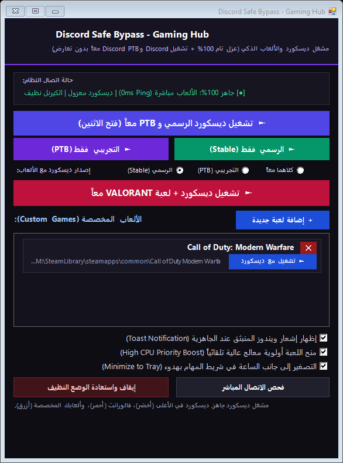
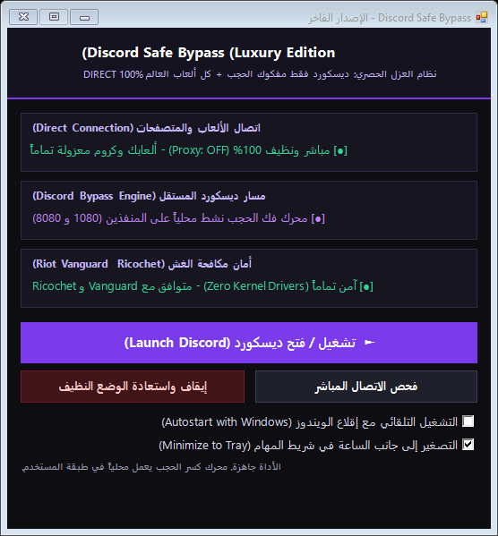

# 🎮 Best-DPI-for-Discord-Turkey

<div align="center">


### 🚀 أداة فك حجب ديسكورد الأقوى والآمنة 100% للاعبين في تركيا
### The Ultimate, Safe & 0ms-Ping Discord DPI Bypass for Gamers in Turkey

[-0078D6?style=for-the-badge&logo=windows)](https://github.com/mohmnleo-dotcom/Best-DPI-for-Discord-Turkey)
[-22c55e?style=for-the-badge&logo=riotgames)](https://github.com/mohmnleo-dotcom/Best-DPI-for-Discord-Turkey)
[-ef4444?style=for-the-badge&logo=speedtest)](https://github.com/mohmnleo-dotcom/Best-DPI-for-Discord-Turkey)
[](https://github.com/mohmnleo-dotcom/Best-DPI-for-Discord-Turkey)

<p align="center">
  <a href="#-باللغة-العربية"><b>العربية</b></a> •
  <a href="#-english"><b>English</b></a> •
  <a href="#-folders-breakdown"><b>المجلدات / Folders</b></a> •
  <a href="#-comparison-جدول-المقارنة"><b>المقارنة / Comparison</b></a> •
  <a href="#-quick-start"><b>البدء السريع / Quick Start</b></a>
</p>

</div>

---

<div align="center">

### 📸 معاينة مشغل الألعاب الذكي | Gaming Hub Preview


### 📸 معاينة النسخة الرسومية | GUI Version Preview


</div>

---

## 🇸🇦 باللغة العربية

### 🌟 ما هي هذه الأداة؟
أداة شاملة ومصممة بعناية فائقة لحل مشكلة حجب تطبيق **Discord** في تركيا، تم بناؤها خصيصاً للاعبين لتوفير أعلى أداء واستقرار تام بدون أي لاغ أو ارتفاع في البنق (0ms Ping Overhead)، مع دعم تشغيل نسختي ديسكورد الرسمية (**Discord Stable**) والتجريبية (**Discord PTB**) معاً على نفس الجهاز في وقت واحد دون أي تعارض!

### 🎯 لماذا تعتبر هذه الأداة الأفضل والوحيدة الآمنة 100%؟
1. 🛡️ **آمنة 100% مع برامج مكافحة الغش (No Kernel Drivers):**
   * الإصدارات القديمة من GoodbyeDPI تعتمد على درايفر `WinDivert.sys` في طبقة الكيرنل، مما يسبب تعارضاً مع مضادات الغش مثل **Riot Vanguard (Valorant)** أو **Easy Anti-Cheat** أو كشفها كبرامج محظورة.
   * هذه الأداة تعمل بالكامل في وضع المستخدم العادي (**User-Mode**) بدون أي درايفرات كيرنل أو تعديلات في النظام الحساس.
2. ⚡ **بنق ألعاب أصلي 0ms (Zero Ping Overhead):**
   * لا تقوم الأداة بتمرير حركة الإنترنت الخاصة بألعابك عبر أي بروكسي!
   * تعتمد نظام **المصافحة الموقوتة الذكية (Smart Handshake)**: يتم تفعيل وسيط العبور لمدة ثوانٍ معدودة فقط أثناء إقلاع ديسكورد لتخطي خطأ فحص التحديثات الشهير (**Update Failed**)، ثم يتم إطفاء البروكسي فوراً ليعود اتصال جهازك وباقي الألعاب (Valorant, Call of Duty, CS2, Steam) والمواقع (مثل PythonAnywhere) نظيفاً ومباشراً 100%.
3. 🚀 **تشغيل نسختي ديسكورد معاً (Discord Stable + Discord PTB):**
   * تم حل مشكلة تشغيل النسختين معاً بتجاوز قفل العملية الواحدة عبر وسيط `--multi-instance`.
   * تم حل تعارض منفذ Discord RPC الشهير (`EADDRINUSE 6463`) تلقائياً ليعمل كلا البرنامجين بحرية تامة جنباً إلى جنب.
4. 🎮 **مشغل ألعاب متكامل (Gaming Launcher):**
   * إطلاق ديسكورد ولعبة فالورانت (أو أي لعبة تختارها من جهازك) بنقرة زر واحدة.
   * معزز تلقائي لأولوية المعالج (**High CPU Priority Boost**) لتثبيت الفريمات ومنع تقطيع الألعاب.
   * إشعارات ويندوز منبثقة (**Toast Notifications**) تؤكد جاهزية اللعب وحالة الاتصال.
   * زر حذف [✕] أحمر فوق كل لعبة مخصصة لإدارتها بسهولة تامة.

---

## 🗂️ هيكلية المجلدات الأربعة (Project Folders)

المشروع منظم في 4 مجلدات مستقلة لتلائم جميع الاستخدامات:

```text
Best-DPI-for-Discord-Turkey/
├── 1_Discord_GUI/             # النسخة الرسومية الفاخرة (Dark Purple UI + System Tray)
├── 2_DosiFix_Cleaner/         # أداة الطوارئ والإصلاح واستعادة إعدادات النظام الأصلية
├── 3_Discord_CMD/             # النسخة الكلاسيكية الخفيفة عبر موجه الأوامر (CMD)
└── 4_Discord_Gaming_Launcher/ # مشغل الألعاب المتطور (فالورانت، ألعاب مخصصة، تشغيل كِلا النسختين)
```

### 1️⃣ `1_Discord_GUI` — النسخة الرسومية الفاخرة
* واجهة رسومية داكنة وأنيقة باللون البنفسجي، تدعم اللغة العربية الرسمية بنسبة 100%.
* إمكانية التصغير بجانب الساعة (System Tray)، وبطاقات متابعة حالة الشبكة الحية.
* زر فحص الاتصال المباشر بزر واحد.
* **ملف التشغيل:** `Discord_Safe_GUI.exe`

### 2️⃣ `2_DosiFix_Cleaner` — أداة الإصلاح الشامل واستعادة النظام
* أداة طوارئ مستقلة تعمل بصلاحية المسؤول (Run as Admin).
* تقوم بنقرة واحدة بإلغاء أي بروكسي معلق في نظام ويندوز، تصفير كاش الـ DNS، تنظيف كاش المتصفحات، وإعادة كل شيء للوضع التلقائي النظيف 100%.
* تحتوي على الكود المصدري الكامل `DosiFix.cs` وملفات السكربت.
* **ملف التشغيل:** `DosiFix.exe`

### 3️⃣ `3_Discord_CMD` — النسخة الكلاسيكية الخفيفة (CMD)
* نسخة فائقة الخفة لا تستهلك أي موارد، تعمل من خلال موجه الأوامر الكلاسيكي.
* بنظام المصافحة الموقوتة والعزل التام لمنافذ ديسكورد.
* **ملف التشغيل:** `Discord_Safe.exe` أو `turkey_dnsredir.cmd`

### 4️⃣ `4_Discord_Gaming_Launcher` — مشغل الألعاب المزدوج الذكي (الأحدث)
* المجلد الرئيسي والأنسب للاعبين:
  - زر أخضر لتشغيل **ديسكورد الرسمي (Discord Stable)**.
  - زر بنفسجي لتشغيل **ديسكورد التجريبي (Discord PTB)**.
  - زر أزرق لتشغيل **كلا النسختين معاً (Both Together)** بنقرة واحدة!
  - زر أحمر لإطلاق ديسكورد ولعبة **VALORANT** معاً.
  - قسم مخصص لإضافة وتشغيل أي لعبة من جهازك (`.exe`) مع إمكانية حذفها بزر [✕].
  - معزز أولوية المعالج (High CPU Priority Boost) وإشعارات ويندوز.
* **ملف التشغيل:** `Discord_Gaming_Launcher.exe`

---

## ⚖️ Comparison | جدول المقارنة

| الميزة / الخاصية | 🎮 Best-DPI (مشروعنا) | ⚠️ GoodbyeDPI التقليدي | 🌐 برامج VPN العادية |
|---|:---:|:---:|:---:|
| **تأثير البنق في الألعاب** | **0ms (اتصال مباشر 100%)** | قد يرفع البنق | زيادة عالية في البنق واللاغ |
| **الأمان مع Vanguard و Anti-Cheat** | **آمن 100% (User-Mode)** | خطر (يستخدم درايفر WinDivert) | خطر حظر الحسابات في بعض الألعاب |
| **حل مشكلة Update Failed** | **تلقائي (مصافحة ذكية)** | يفشل التحديث غالباً | ينجح التحديث لكن ببطء شديد |
| **تشغيل نسختي ديسكورد معاً (Stable + PTB)** | **مدعوم بنقرة واحدة** | غير مدعوم | يحتاج ضبطاً يدوياً معقداً |
| **التأثير على باقي البرامج والمواقع** | **صفر (لا يؤثر على Steam أو المواقع)** | قد يؤثر على المتصفحات | يغير مسار كل اتصالات جهازك |
| **أداة تنظيف واستعادة تلقائية (DosiFix)** | **مدمجة وجاهزة بنقرة واحدة** | غير متوفرة | تحتاج تنظيفاً يدوياً |

---

## 🚀 Quick Start | البدء السريع

1. قم بتحميل المشروع إما عن طريق استنساخ المستودع عبر Git:
   ```bash
   git clone https://github.com/mohmnleo-dotcom/Best-DPI-for-Discord-Turkey.git
   ```
   أو بالضغط على **Code -> Download ZIP** وفك الضغط.
2. ادخل إلى مجلد `4_Discord_Gaming_Launcher`:
   - شغّل `Discord_Gaming_Launcher.exe`.
   - اضغط الزر الذي يناسبك (ديسكورد الرسمي، ديسكورد التجريبي PTB، أو تشغيل الاثنين معاً).
3. للعب فالورانت أو ألعابك المفضلة:
   - اضغط زر **VALORANT** أو أضف لعبتك المخصصة عبر زر **[+ إضافة لعبة جديدة]**.
   - ستنطلق اللعبة مع ديسكورد بدون أي لاغ وبإشعار تأكيد جاهزية النظام.
4. عند الانتهاء أو إذا احتجت تنظيف النظام في أي وقت:
   - اضغط زر **"إيقاف واستعادة الوضع النظيف"** داخل المشغل، أو شغّل `DosiFix.exe` من مجلد `2_DosiFix_Cleaner`.

---

## 🇬🇧 English

### Overview
**Best-DPI-for-Discord-Turkey** is an advanced, user-mode DPI bypass toolkit specifically engineered for gamers in Turkey where Discord is blocked. Unlike conventional DPI workarounds or full-tunnel VPNs that inflate in-game latency and trigger anti-cheat software, this project provides **0ms added ping** and **100% compatibility with anti-cheats (Riot Vanguard, BattlEye, Easy Anti-Cheat)** by operating entirely in user-mode without kernel drivers.

### Key Highlights
* **Zero Ping Overhead (Direct Gaming Mode):** Features an intelligent timed handshake mechanism. The bypass is temporarily active for a few seconds during Discord's initial boot sequence to bypass the infamous `Update Failed` loop, then automatically resets system proxy settings (`ProxyEnable = 0`). Your games (Valorant, Call of Duty, Steam, etc.) communicate directly with game servers over your native internet connection.
* **Dual Discord Instance Support:** Seamlessly run **Discord Stable** and **Discord PTB** simultaneously on a single machine without process collisions. Automatically mitigates Discord RPC port contention (`EADDRINUSE 6463`).
* **All-in-One Gaming Hub:**
  - One-click duo launcher for Discord + Valorant or any custom game executable.
  - Automated High CPU Priority booster for game processes.
  - Windows Toast Notifications for instant launch confirmation.
  - Interactive Custom Game manager with quick-delete `[✕]` controls.
* **Built-in DosiFix Recovery Tool:** One-click administrator rescue utility to flush DNS caches, remove stale proxies, and restore standard Windows networking configuration.

### Technical Architecture
* **Core Engine:** `ciadpi` (user-mode DPI packet fragmentation engine) running locally on loopback.
* **HTTP Bridge:** Custom lightweight C# proxy bridge isolating Discord domains (`*.discord.com`, `*.discord.gg`, `*.dis.gd`) while passing all other traffic direct.
* **Multi-Instance Injection:** Dispatches `--multi-instance` and isolated proxy flags via Discord's `Update.exe` bootstrapper.
* **WinINet Dynamic Refresh:** Invokes `InternetSetOption` (options 37 & 39) via P/Invoke to guarantee real-time proxy state propagation across Windows services without requiring system reboots.

### Compiling from Source
All source code files are included in the repository:
* `4_Discord_Gaming_Launcher/DiscordGamingLauncher.cs`
* `2_DosiFix_Cleaner/DosiFix.cs`
* `4_Discord_Gaming_Launcher/http_bridge.cs`

To compile using Microsoft .NET Framework C# compiler (`csc.exe`):
```powershell
& "C:\Windows\Microsoft.NET\Framework64\v4.0.30319\csc.exe" /target:winexe /win32icon:discord_purple_black.ico /out:Discord_Gaming_Launcher.exe DiscordGamingLauncher.cs
```

---

## 📜 Disclaimer & License
* This project is provided for educational and personal utility purposes.
* Discord, VALORANT, Call of Duty, and Steam are trademarks of their respective owners.
* Distributed under the [MIT License](LICENSE).
